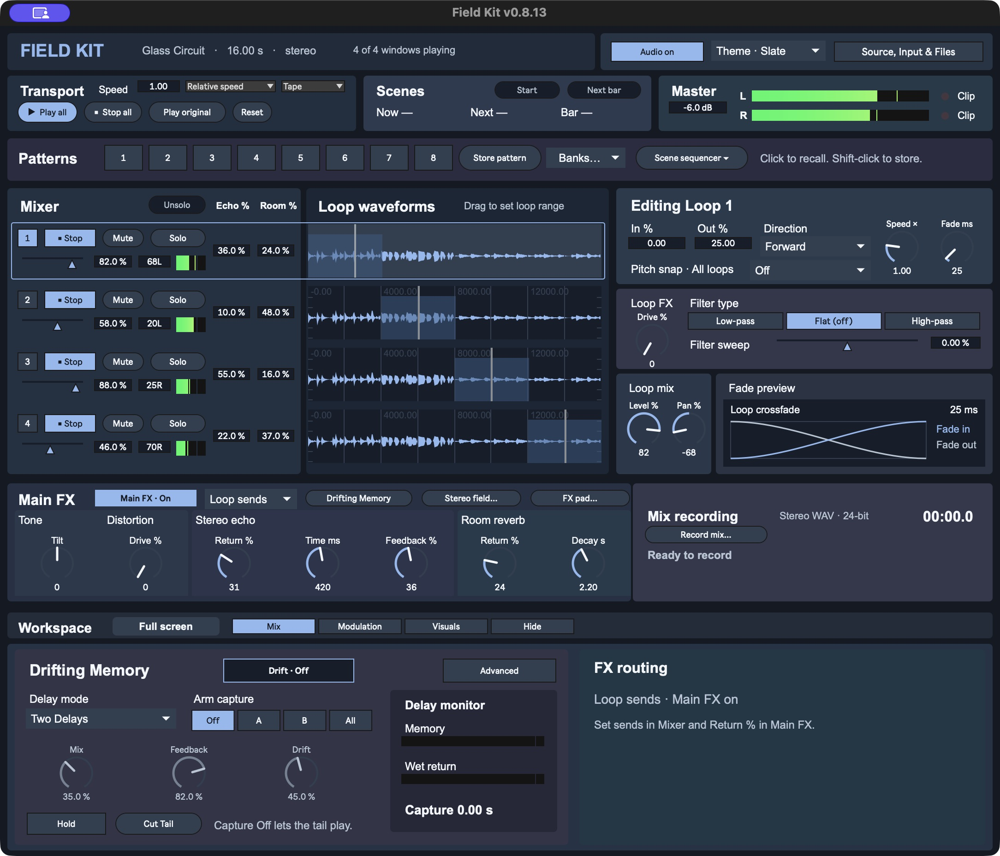
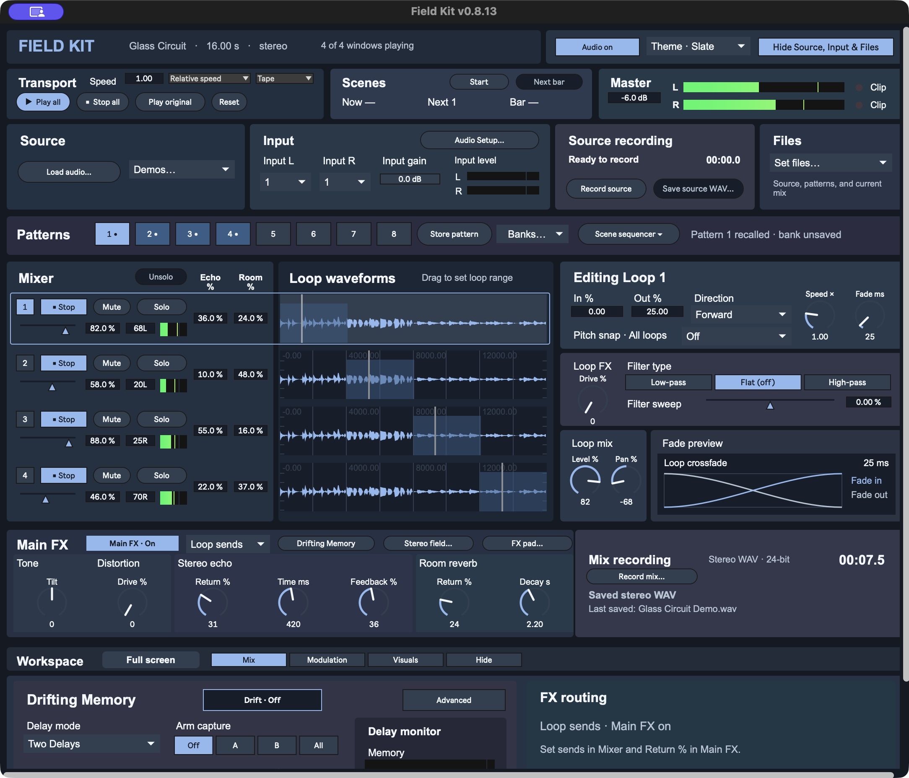
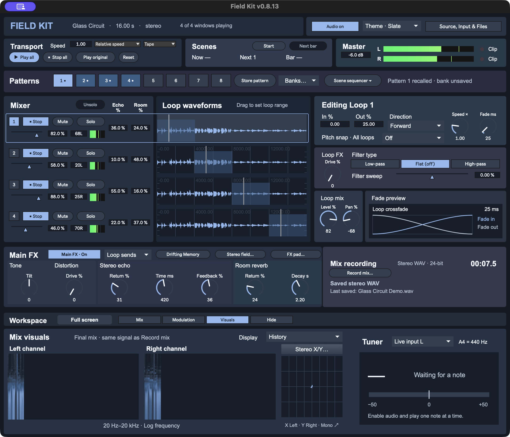
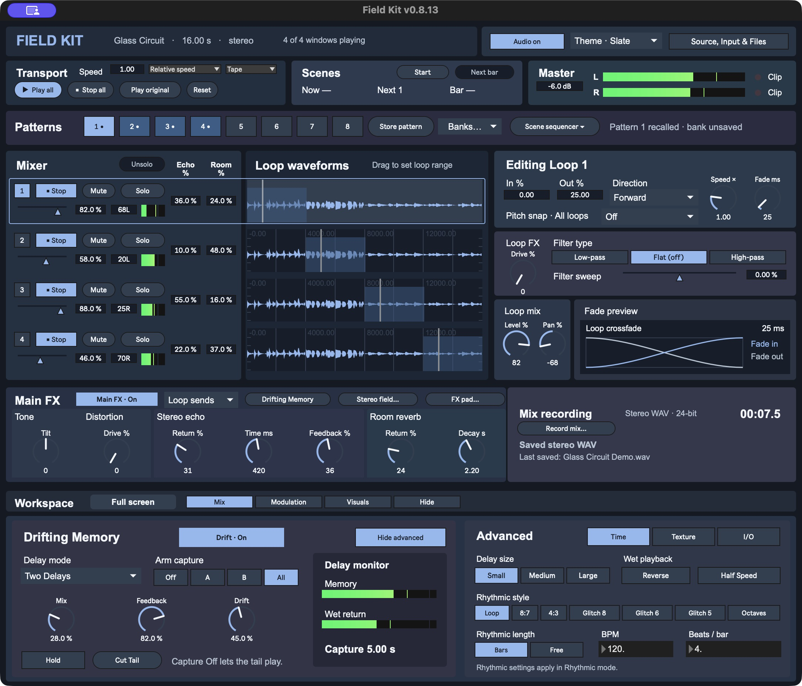
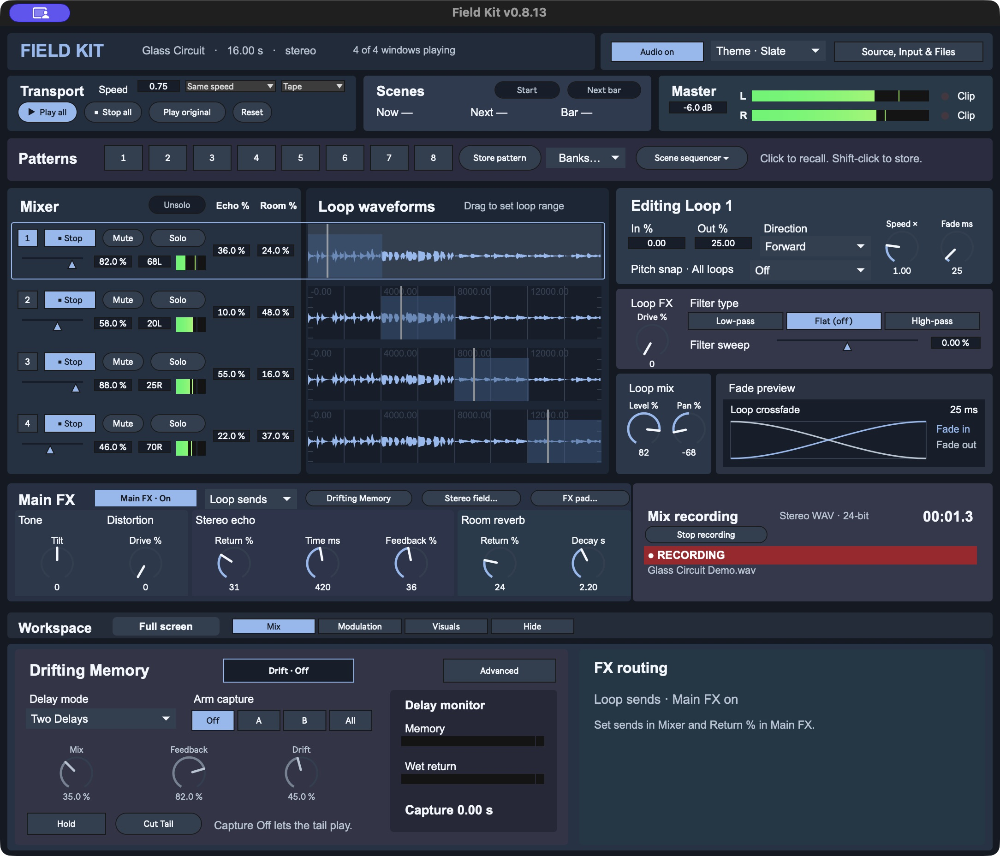

# FIELD KIT

FIELD KIT is a Max instrument that turns an audio file or a live recording into four independent stereo loops. Set each loop's range, speed, direction, crossfade, drive, and filter. Blend the loops in the performance mixer, move them with eight LFOs, and capture the stereo mix with the built-in recorder.

## Start here

- **[Download the latest Max patch](https://github.com/modelcollapse/field-kit/releases/latest/download/field-kit-max.zip).** Unzip it and double-click **Open FIELD KIT.maxpat** in Max 9. **START HERE.txt** has the quick instructions. Keep **Support** and the companion Max patches beside the launcher.
- **[Download the latest standalone macOS app](https://github.com/modelcollapse/field-kit/releases/latest/download/field-kit-macos.zip).** Unzip it and open **Field Kit.app**. Max is not required.

The v0.8.13 standalone includes Apple silicon and Intel binaries. It is ad hoc signed and has no Apple notarization. macOS may show a first launch alert. [Apple’s explanation of first launch alerts](https://support.apple.com/en-us/102445).

[See what's new in v0.8.13](CHANGELOG.md).



The original demo loads on startup. Click **Play all** to hear it. Open **Source, Input & Files → Demos…** to play **Glass Circuit** (120 BPM), **Tidal Lanterns** (75 BPM), or the original demo. Each new demo uses four equal loop regions and sets the scene tempo to match. Choose **Load audio…** to play your own sample. The same drawer holds audio setup, source recording, and Set files.

Choose **Slate**, **Moss**, or **Ember** from the **Theme** menu in the header. Each theme uses related background shades to separate source setup, the mixer, loop controls, effects, and recording.

In the selected loop editor, choose **Low-pass** to cut highs, **High-pass** to cut lows, or **Flat (off)** to center the filter. Switch between Low-pass and High-pass to keep the same strength, or drag **Filter sweep** for a continuous move through all three. **Drive** is off at 0%. Patterns, Sets, and LFO routes still use each loop’s filter sweep.


## Record a source

1. Open **Source, Input & Files**, select your interface in **Audio Setup…**, and click **Enable audio**. In **Input**, choose the left and right channels. Select the same channel on both sides for a mono source.
2. Set the linked input gain from −60 to +18 dB. It starts at 0 dB. The two peak meters show the levels after gain, with peak hold and a red overload indicator.
3. Click **Record source** to capture up to 60 seconds. The red **RECORDING** badge and timer show when audio is being captured. **Stop source** loads the take into all four loops. Use **Save source WAV…** before saving a Set that uses the take or replacing the source.



## Play and shape the loops

1. Click a loop number or waveform to select it. **Editing Loop** sits beside the waveforms and shows the selected loop's settings. Drag across a waveform and release to change its range. The moving line shows playback position.
2. Use **In %** and **Out %** to enter the bounds precisely. Choose **Forward**, **Reverse**, or **Ping-pong** and adjust the dials.
3. **Fade ms** blends each pass into the next. **Fade preview** shows the two gain curves and the overlap duration. The live duration reflects short-loop limits, speed, and modulation. **Filter** is flat at zero. Turn left to cut highs or right to cut lows.

**Pitch snap** applies to all four windows. Choose a scale to snap the pitch reached by changing **Speed ×**, including speed modulation. The original sample at **1×** is the tonic. Speed and pitch stay linked, as on a tape deck.

Use **Speed** in Transport to slow down or speed up all four loops from **0.50×** to **2.00×**. **Relative speed** multiplies each loop’s speed after pitch snap. If two loops are set to 1× and 2×, setting global Speed to 0.50× plays them at 0.50× and 1×. **Same speed** would play both at 0.50×. Switching back to Relative speed uses each loop’s individual speed setting again.

**Tape** changes pitch with speed. Choose **Pitch Lock** to keep pitch steady while you turn the global Speed control. In Relative speed, this preserves each loop’s pitch at 1× global speed, including any local speed or Pitch Snap settings. In Same speed, it preserves the source pitch. **Save Set** stores the global speed and both modes. Pattern changes leave them in place.

Open **Visuals** and set the **Tuner** source to **Live input L**, **Live input R**, or **Selected loop**. With audio enabled, play one note at a time. The tuner shows the nearest note, frequency, and cents relative to **A4 = 440 Hz**.

**Play original** plays the original sample once at its original speed, with the window mixer and effects bypassed. Switching between original playback and the loop mix uses a short crossfade. **Stop all** stops playback. **Reset** also restores the default loop, mixer, modulation, and effects settings. It keeps the current sample and stored patterns.

## Mix the four windows

Each waveform has a mixer strip with playback, level, pan, mute, solo, a peak meter, and **Echo** and **Room** sends. Click or drag the blue fader under a window’s playback button to set its volume, or edit the percentage box for a precise level. **Mute** removes a window from the mix while its loop keeps running. **Solo** lets you hear one or more windows together. Mute still takes precedence, and **Unsolo** brings back the current mute mix. Mixer performance controls leave the edit selection in place. **Record mix** captures the resulting master mix.

The **L** and **R** meters in the **Master** strip show each output channel. A red **Clip** light shows which channel hit the output ceiling. Lower **Master** if either light comes on. The **Mix recording** panel below has the recording button, timer, status, and take name.

Open **Stereo field…** beside **FX pad…** in the **Main FX** header. Drag a window edge to resize the Stereo Field. The tabs select which loop's pan and level are shown above the pad. Drag its dot left or right to pan it, and up or down to change its level. If dots overlap, use the tabs to pick one.

Use **Field presets** to store four arrangements of all four loops' pan and level. Shift-click a slot, or click **Store preset** and pick a slot. Click a filled slot to recall it. Recall stops current Stereo Field movement so the positions stay where you set them. **Save Set…** keeps the presets with your session.

To record movement, select a loop, click **Record**, then drag its dot as many times as you like. Click **Finish** to save and start looping the take. It also starts looping when it reaches 30 seconds. The **Play / Stop** button controls playback and **Clear** erases the gesture. Each loop keeps one gesture and can play it alongside the others. Click **Play paths** to start every recorded Stereo Field gesture. Paths already running keep their place. Once all recorded paths are running, click **Stop paths** to stop the gestures while the audio loops keep playing. Click **Show all paths** to see the recorded paths together, color-coded to match the numbered loop markers. Click **Show selected path** to focus on one loop.

## Store patterns

Shift-click one of the eight squares to store the current pattern, or click **Store pattern** and pick a square. A dot marks a stored pattern, and the brightest square is the last one you stored or recalled. Click a dotted square to recall its loop settings, mixer levels, pans and mutes, pitch scale, LFO routes and curves, and effects on the current sample. During playback, Field Kit holds a short buffer of the outgoing stereo mix and crossfades into the new pattern over 100 ms. Scene changes use the same transition. **Fade ms** in the loop editor still controls only that loop's seam. Recall clears active solos. Click **Cancel store** to exit store mode.

Open **Source, Input & Files** and use **Save Set…** in the **Set files…** menu to save the source file location, all eight slots, and your current settings in one file. **Open Set…** restores the session with playback stopped. If the sample moved, choose its new location.

Open **Banks…** to load or save a bank of patterns.

Banks from the three-LFO version still open. Their settings are restored on LFOs 1–3. LFOs 4–8 start at their defaults with no routes.

Click **Scene sequencer** beside **Banks…** to show the eight steps directly under Patterns. Click **Hide sequencer** in the same spot to return to your previous workspace while the sequence keeps playing. Set **BPM** and **Beats/bar**, then choose a scene and duration in bars for each step. **Start** starts with the first available scene, and **Next bar** advances early at the next bar line. **Repeat** loops the sequence. **Stop** holds the current scene and lets the loops continue. **Stop all** stops the sequencer and the loops. Selecting a pattern by hand stops the sequence and recalls that pattern.

The scene clock controls when patterns change. Set the tempo and meter before you start. Loop speed still follows each loop's **Speed ×** setting. **Save Set…** saves the sequence, tempo, and meter with the patterns. **Open Set…** restores them ready to start.

The scene strip at the top, between **Transport** and **Master**, shows the current scene, the next playable scene, and progress through the current scene’s bars. Use **Start** or **Stop** and **Next bar** directly from the strip.


Use the workspace selector to switch between **Mix**, **Modulation**, and **Visuals**, or **Hide** to collapse the lower panel. **Mix** opens by default. On wide displays, **Full screen** puts **Mix recording** and **Mix visuals** in a right column that stays visible as you switch workspaces. Select **Visuals** there to show the tuner below the workspace tabs while the analyzers stay in the right column.

**Visuals** monitors the same final stereo signal as **Record mix**. Choose **History** for a scrolling frequency history or **Spectrum** for a live frequency curve, with a separate view for each channel. Click **Stereo X/Y…** above the scope to open a larger, resizable window. The scope plots left against right. Matching left and right signals trace a rising diagonal. Opening Stereo X/Y or Stereo Field from full screen returns the workspace to a window so you can see both at once.




## Patch modulation

Each of the eight LFOs can reach any of the 66 destinations. Choose a loop to modulate its range, speed, direction, crossfade, drive, filter, level, pan, or Echo and Room sends. Choose **Global** for master level, input gain, Main FX, and Drifting Memory. Pick a destination, then turn **Depth** or click **Add route** to start at +25%. Negative depth inverts the LFO. The **active routes** menu jumps to a route for the selected LFO. **Applied value** shows what the destination receives while audio is on.

In **Loop sends** mode, the per-loop send routes control which loops feed Echo and Room. In Drifting Memory, the HPF and LPF routes take effect in **Sweep**, and the timing routes take effect in **Rhythmic**. Older Sets and pattern banks keep their existing LFO assignments when opened.

The lower-left graph shows one cycle of the selected LFO’s shape. Choose **Breakpoint** or click **Use curve** to edit that LFO’s custom curve. Click to add a point, drag to move it, or Shift-click to delete it. Each LFO keeps its curve when you switch shapes. The graph on the right shows the live signal when audio is on.


## Process and capture

Field Kit starts dry with Main FX and Drifting Memory off. Their dimmed dials show the stored values and can still be edited. During loop playback, click **Main FX · Off** beside the Main FX heading to turn on tone, stereo echo, and room reverb. The button fills with the theme color and reads **Main FX · On**. Tone is neutral at zero, and echo time ranges from 45 to 850 ms.

**Full mix** applies Echo and Room to the combined loops. Their dials read **Mix %**. For per-loop routing, select **Loop sends** and turn up **Echo** or **Room** on the desired mixer strip. The main dials read **Return %** and set how much of each effect comes back into the mix. Start with a nonzero return, then raise the send for the loop you want to hear. The read-only **FX routing** panel shows the current mode and whether Main FX is on. Sets and patterns remember the mode, returns, and send amounts.

[See the mixer sends, Main FX returns, and read-only routing status together](docs/screenshots/field-kit-performance-sends.jpg).

Open **FX pad…** and use the **X** and **Y** menus to pair Tone tilt, Echo mix, Room mix, or Distortion. X starts on Echo mix and Y starts on Room mix. Picking the other axis’s effect swaps the pair. Drag right or up to increase the assigned value. Tone tilt moves from dark through neutral to bright. The pad and dials stay in sync.

Click **● Record** in the FX pad to arm it. Drag across the grid as many times as you like, then click **Finish** to save and start looping the take. It also starts looping when it reaches 30 seconds. The status below the buttons shows elapsed time while you record, then the saved duration and effect pair. **Play / Stop** starts or stops playback. Stopping holds the current values, and **Clear** erases the gesture. Turn on Main FX in the pad or the Main FX header to hear it. Both buttons control the same effects. **Distortion** adds soft clipping to the stereo mix and is off at 0%. **Close** hides either pad and lets its gestures keep playing. **Stop all**, resetting, or recalling a pattern stops gesture playback. In Loop sends, the FX pad calls the Echo and Room axes **Echo return** and **Room return**. **Save Set** keeps the FX pad gesture and all four Stereo Field gestures. Open the Set and click **Play** on either pad to replay a saved gesture.

| Stereo field | FX pad |
| --- | --- |
|  |  |

**Drifting Memory** runs at the end of Main FX. In **Mix**, click **Drift · Off** to turn it on, play the loops, then choose **All** under **Arm capture**. With **Two Delays** and **Small**, the first return takes about 2½ seconds. The **Memory** meter shows what’s circulating in the delay. **Wet return** shows what the delay adds to the final mix. Use **Mix** to blend it in. Choose **Off** under **Arm capture** to stop recording into memory while the tail plays. Sets and patterns save the effect settings. Captured memory is for the current session.

Click **Advanced** to show the **Time**, **Texture**, and **I/O** controls beside Drifting Memory. The **Drifting Memory** shortcut in Main FX opens the same view. The mixer sends stay visible and the delay and its capture continue while you switch views.

Use **Hold** to freeze what’s in memory. **Cut Tail** clears the captured audio and turns capture off while the dry mix keeps playing. To capture again, release **Hold** if it’s on and choose a capture bank.



With audio enabled, click **Record mix…** and choose where to save the take. The red **RECORDING** indicator and timer show when capture is active. The recorder writes the final mix as a 24-bit stereo WAV at the audio device's current sample rate. **Stop all** lets the effects decay. Click the same button, now labeled **Stop recording**, to finish and save the take.



## Build and test

From a source checkout, open [Field Kit.maxpat](max/Field%20Kit.maxpat) in Max 9. The patch, its support files, and the demo live together in [`max/`](max/). Build and packaging tools are in [`scripts/`](scripts/).

Run `python3 scripts/build.py` to regenerate the patch, subpatchers, and demo. Run `python3 scripts/package_max_download.py build/field-kit-max.zip` to package the editable download.

To build the standalone app, run `python3 scripts/prepare_max_project.py max build/standalone`. Open the generated **Field Kit.maxproj** in Max and choose **File → Build Collective / Application… → Application**. [Cycling ’74 standalone build guide](https://docs.cycling74.com/userguide/standalones_and_collectives/)

See the [release checklist](docs/releasing.md) for building, testing, and publishing both downloads and their screenshots.

Run the playback startup, input recording, pattern bank, scene timing, curve editing, Set writer, and FX pad recording tests with Node.js.

```sh
node tests/source_launch_verify.cjs
node tests/input_record_verify.cjs
node tests/pattern_bank_verify.cjs
node tests/sequence_mix_verify.cjs
node tests/curve_fade_verify.cjs
node tests/set_writer_verify.cjs
node tests/fx_pad_verify.cjs
```

The playback and modulation brief was inspired by Field Tone Audio's FIELD KIT. [Original instrument](https://fieldtoneaudio.gumroad.com/l/field-kit)
