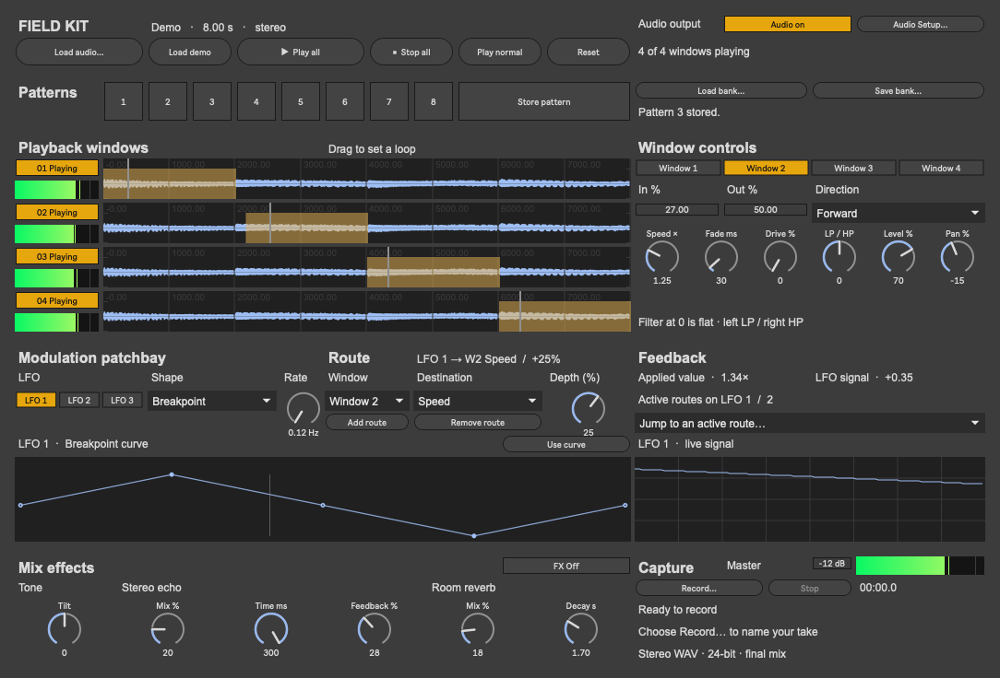
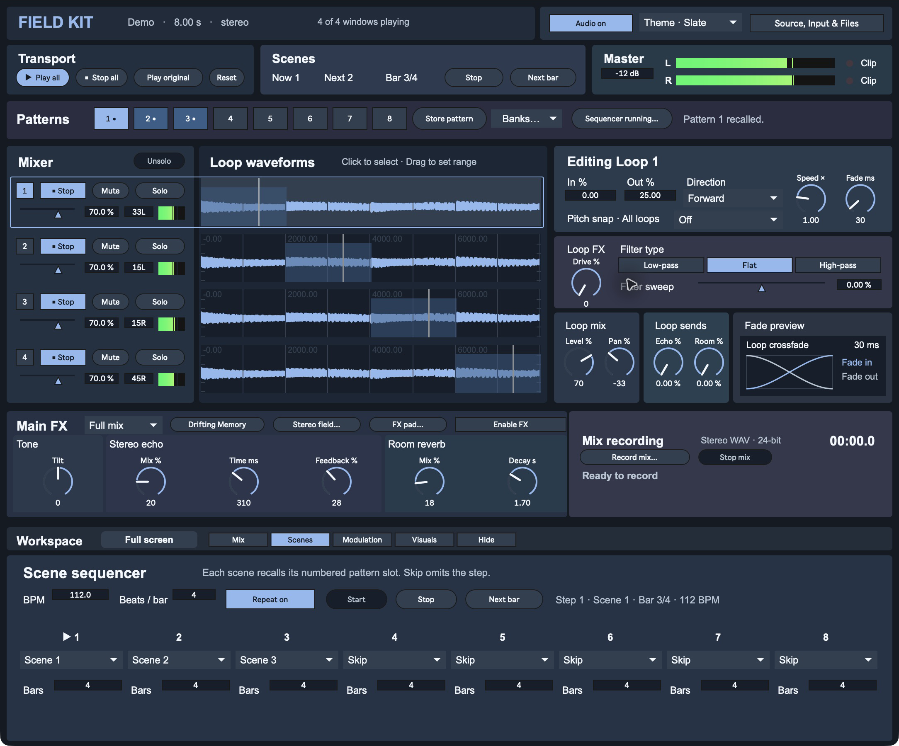
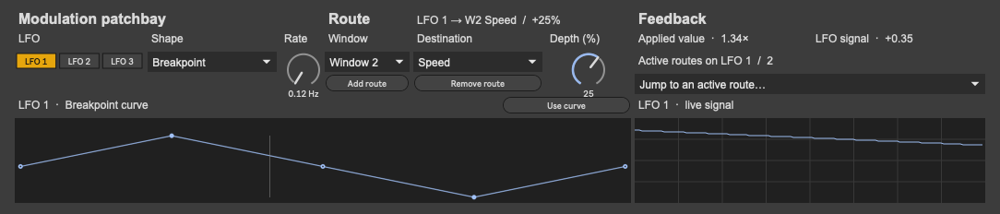
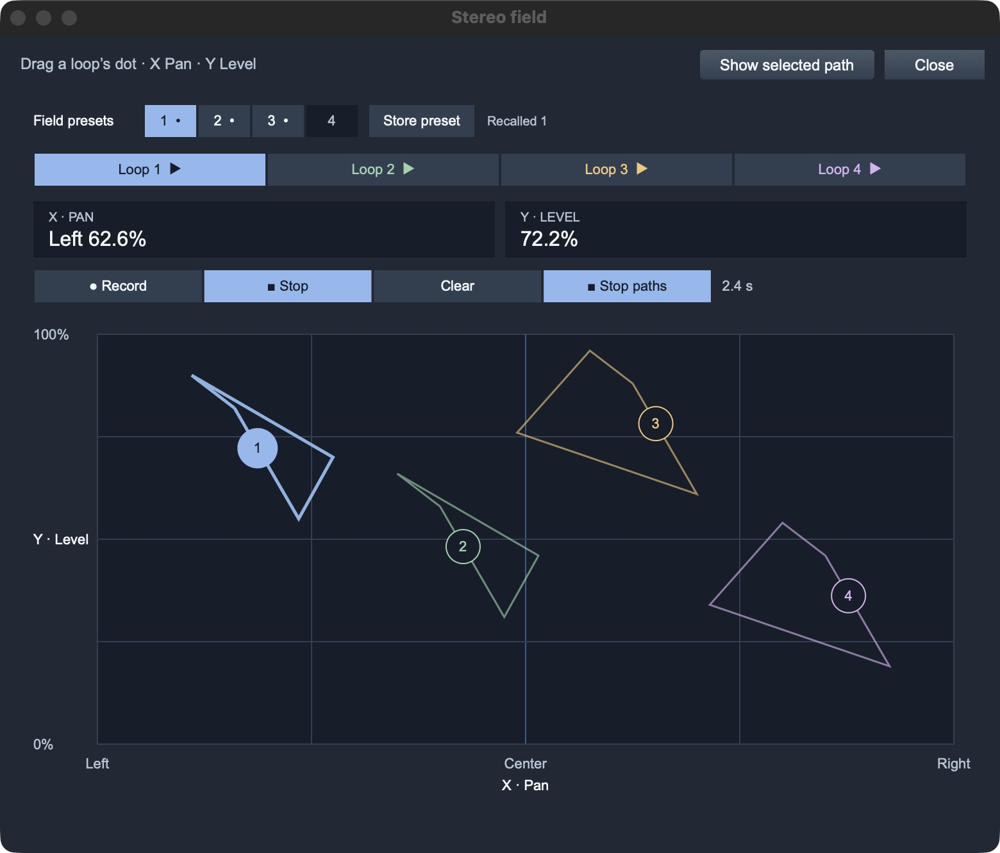
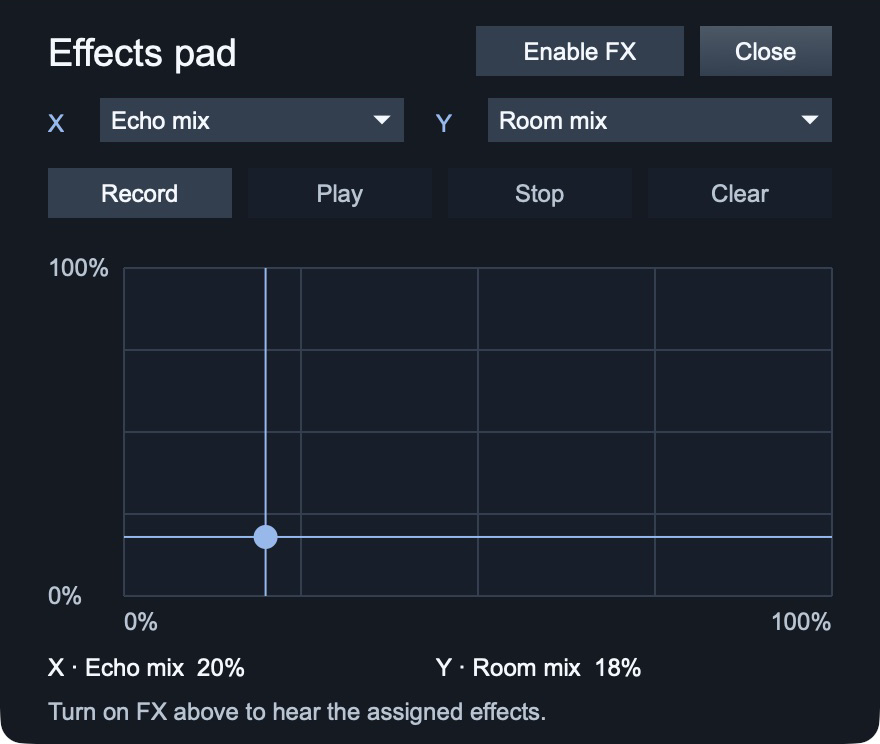

# FIELD KIT

FIELD KIT is a Max instrument that turns an audio file or a live recording into four independent stereo loops. Set each loop's range, speed, direction, crossfade, drive, and filter. Blend the loops in the performance mixer, move them with eight LFOs, and capture the stereo mix with the built-in recorder.

## Start here

- **[Download the latest Max patch](https://github.com/modelcollapse/field-kit/releases/latest/download/field-kit-max.zip).** Unzip it and double-click **Open FIELD KIT.maxpat** in Max 9. **START HERE.txt** has the quick instructions. Keep **Support** and the companion Max patches beside the launcher.
- **[Download the latest standalone macOS app](https://github.com/modelcollapse/field-kit/releases/latest/download/field-kit-macos.zip).** Unzip it and open **Field Kit.app**. Max is not required.

The v0.7.0 standalone is ad hoc signed and is not notarized by Apple. macOS may block the first launch of a browser download. [Apple’s explanation of first launch alerts](https://support.apple.com/en-us/102445). [See the standalone running the demo with live Spectrum and Stereo X/Y](docs/screenshots/field-kit-standalone.jpg).

[See what's new in v0.7.0](CHANGELOG.md).

The eight-second demo loads on startup. Click **Play all** to turn on audio and start the four loops, or click one window's play button to hear it on its own. Open **Source, Input & Files** and choose **Load audio…** to load a sample and start its four loops as soon as the file is ready. The same drawer holds audio setup, source recording, and Set files. **Enable audio** starts the engine without starting playback.

Choose **Slate**, **Moss**, or **Ember** from the **Theme** menu in the header. Each theme uses related background shades to separate source setup, the mixer, loop controls, effects, and recording.

In the selected loop editor, choose **Low-pass** to cut highs, **High-pass** to cut lows, or **Flat** to center the filter. Switch between Low-pass and High-pass to keep the same strength, or drag **Filter sweep** for a continuous move through all three. Patterns, Sets, and LFO routes still use each loop’s filter sweep.



## Record a source

1. Open **Source, Input & Files**, select your interface in **Audio Setup…**, and click **Enable audio**. In **Input**, choose the left and right channels. Select the same channel on both sides for a mono source.
2. Set the linked input gain from −60 to +18 dB. It starts at 0 dB. The two peak meters show the levels after gain, with peak hold and a red overload indicator.
3. Click **Record source** to capture up to 60 seconds. The red **RECORDING** badge and timer show when audio is being captured. **Stop source** loads the take into all four loops. Use **Save source WAV…** before saving a Set that uses the take or replacing the source.

## Play and shape the loops

1. Click a loop number or waveform to select it. **Editing Loop** sits beside the waveforms and shows the selected loop's settings. Drag across a waveform and release to change its range. The moving line shows playback position.
2. Use **In %** and **Out %** to enter the bounds precisely. Choose **Forward**, **Reverse**, or **Ping-pong** and adjust the dials.
3. **Fade ms** blends each pass into the next. **Fade preview** shows the two gain curves and the overlap duration. The live duration reflects short-loop limits, speed, and modulation. **Filter** is flat at zero. Turn left to cut highs or right to cut lows.

**Pitch snap** applies to all four windows. Choose a scale to snap the pitch reached by changing **Speed ×**, including speed modulation. The original sample at **1×** is the tonic. Speed and pitch stay linked, as on a tape deck.

**Play original** plays the original sample once at its original speed, with the window mixer and effects bypassed. Switching between original playback and the loop mix uses a short crossfade. **Stop all** stops playback. **Reset** also restores the default loop, mixer, modulation, and effects settings. It keeps the current sample and stored patterns.

## Mix the four windows

Each waveform has a mixer strip with playback, level, pan, mute, solo, and a peak meter. Click or drag the blue fader under a window’s playback button to set its volume, or edit the percentage box for a precise level. **Mute** removes a window from the mix while its loop keeps running. **Solo** lets you hear one or more windows together. Mute still takes precedence, and **Unsolo** brings back the current mute mix. Mixer performance controls leave the edit selection in place. **Record mix** captures the resulting master mix.

The **L** and **R** meters in the **Master** strip show each output channel. A red **Clip** light shows which channel hit the output ceiling. Lower **Master** if either light comes on. The **Mix recording** panel below has the record and stop controls, timer, status, and take name.

Open **Stereo field…** beside **FX pad…** in the **Main FX** header to place all four loops together. The tabs select which loop's pan and level are shown above the pad. Drag its dot left or right to pan it, and up or down to change its level. If dots overlap, use the tabs to pick one.

To record movement, select a loop, click **Record**, then drag and release its dot. Click **Play** to repeat the movement, **Stop** to hold the current position, or **Clear** to erase the gesture. Each loop keeps one gesture and can play it alongside the others.

## Store patterns

Shift-click one of the eight squares to store the current pattern, or click **Store pattern** and pick a square. A dot marks a stored pattern, and the brightest square is the last one you stored or recalled. Click a dotted square to recall its loop settings, mixer levels, pans and mutes, pitch scale, LFO routes and curves, and effects on the current sample. During playback, the output briefly fades down and back up around the switch. Recall clears active solos. Click **Cancel store** to exit store mode.

Open **Source, Input & Files** and use **Save Set…** in the **Set files…** menu to save the source file location, all eight slots, and your current settings in one file. **Open Set…** restores the session with playback stopped. If the sample moved, choose its new location.

Open **Banks…** to load or save a bank of patterns.

Banks from the three-LFO version still open. Their settings are restored on LFOs 1–3. LFOs 4–8 start at their defaults with no routes.

Open **Scene sequencer…** beside **Banks…** to show the Scenes workspace and chain up to eight stored patterns. Set **BPM** and **Beats/bar**, then choose a scene and duration in bars for each step. **Start** starts with the first available scene, and **Next bar** advances early at the next bar line. **Repeat** loops the sequence. **Stop** holds the current scene and lets the loops continue. **Stop all** stops the sequencer and the loops. Selecting a pattern by hand stops the sequence and recalls that pattern.

The scene clock controls when patterns change. Set the tempo and meter before you start. Loop speed still follows each loop's **Speed ×** setting. **Save Set…** saves the sequence, tempo, and meter with the patterns. **Open Set…** restores them ready to start.

The scene strip at the top, between **Transport** and **Master**, shows the current scene, the next playable scene, and progress through the current scene’s bars. Use **Start** or **Stop** and **Next bar** directly from the strip.



Use the workspace selector to switch between **Mix**, **Scenes**, **Modulation**, and **Visuals**, or **Hide** to collapse the lower panel. **Mix** opens by default. On wide displays, **Full screen** puts **Mix recording** and **Mix visuals** in a right column that stays visible as you switch workspaces. Select **Visuals** there to collapse the lower panel and focus on the analyzers.

**Visuals** monitors the same final stereo signal as **Record mix**. Choose **History** for a scrolling frequency history or **Spectrum** for a live frequency curve, with a separate view for each channel. The stereo scope plots left against right. Matching left and right signals trace a rising diagonal.

## Patch modulation

Choose **LFO 1–8** from the dropdown and set its rate and shape. Choose a loop to modulate its range, speed, direction, crossfade, drive, filter, level, pan, or Echo and Room sends. Choose **Global** for master level, input gain, Main FX, and Drifting Memory. Pick a destination, then turn **Depth** or click **Add route** to start at +25%. Negative depth inverts the LFO. The **active routes** menu jumps to a route for the selected LFO. **Applied value** shows what the destination receives while audio is on.

In **Loop sends** mode, the per-loop send routes control which loops feed Echo and Room. In Drifting Memory, the HPF and LPF routes take effect in **Sweep**, and the timing routes take effect in **Rhythmic**. Older Sets and pattern banks keep their existing LFO assignments when opened.

The lower-left graph shows one cycle of the selected LFO’s shape. Choose **Breakpoint** or click **Use curve** to edit that LFO’s custom curve. Click to add a point, drag to move it, or Shift-click to delete it. Each LFO keeps its curve when you switch shapes. The graph on the right shows the live signal when audio is on.



## Process and capture

During loop playback, click **Enable FX** to turn on tone, stereo echo, and room reverb. Set an effect's **Mix %** to zero to remove it from the mix. Tone is neutral at zero, and echo time ranges from 45 to 850 ms.

**Full mix** applies Echo and Room to the combined loops. To give each loop its own amount, select **Loop sends** and use the four rows in the **Mix** workspace. The loop editor adjusts the same amounts for the selected loop. **Return level** adjusts the same Echo and Room mix controls as the Main FX dials. Sets and patterns remember the mode and the send amounts.

Open **FX pad…** and use the **X** and **Y** menus to pair Tone tilt, Echo mix, or Room mix. X starts on Echo mix and Y starts on Room mix. Picking the other axis’s effect swaps the pair. Drag right or up to increase the assigned value. Tone tilt moves from dark through neutral to bright. The pad and dials stay in sync.

Click **Record**, drag across the FX pad, and release. **Play** loops the gesture using the effect pair you recorded. **Stop** holds the current values and **Clear** erases the gesture. Turn on **Enable FX** in the pad or the Main FX header to hear it. Both buttons control the same Tone, Echo, and Room switch. Gestures in both pads stay available while the patch is open. **Stop all**, resetting, or recalling a pattern stops gesture playback; Sets and patterns save control values but do not store gestures.

| Stereo field | FX pad |
| --- | --- |
|  |  |

**Drifting Memory** runs at the end of Main FX. In **Mix**, click **Enable effect**, play the loops, then choose **All** under **Arm capture**. With **Two Delays** and **Small**, the first return takes about 2½ seconds. The **Memory** meter shows what’s circulating in the delay. **Wet return** shows what the delay adds to the final mix. Use **Mix** to blend it in. **Off** stops capture and lets the tail play. Sets and patterns save the effect settings. Captured memory is for the current session.

Click **Advanced** to show the **Time**, **Texture**, and **I/O** controls beside Drifting Memory. The **Drifting Memory** shortcut in Main FX opens the same view. Click **Hide advanced** to bring back Loop sends. The delay and its capture continue while you switch views.

Use **Hold** to freeze what’s in memory. **Cut Tail** clears the captured audio and turns capture off while the dry mix keeps playing. To capture again, release **Hold** if it’s on and choose a capture bank.

With audio enabled, click **Record mix…** and choose where to save the take. The red **RECORDING** indicator and timer show when capture is active. The recorder writes the final mix as a 24-bit stereo WAV at the audio device's current sample rate. **Stop all** lets the effects decay. Click **Stop mix** when the take is finished.

## Build and test

From a source checkout, open [Field Kit.maxpat](max/Field%20Kit.maxpat) in Max 9. The patch, its support files, and the demo live together in [`max/`](max/). Build and packaging tools are in [`scripts/`](scripts/).

Run `python3 scripts/build.py` to regenerate the patch, subpatchers, and demo. Run `python3 scripts/package_max_download.py build/field-kit-max.zip` to package the editable download.

To build the standalone app, run `python3 scripts/prepare_max_project.py max build/standalone`. Open the generated **Field Kit.maxproj** in Max and choose **File → Build Collective / Application… → Application**. [Cycling ’74 standalone build guide](https://docs.cycling74.com/userguide/standalones_and_collectives/)

See the [release checklist](docs/releasing.md) for building, testing, and publishing both downloads and their screenshots.

Run the playback startup, input recording, pattern bank, curve editing, and Set writer tests with Node.js.

```sh
node tests/source_launch_verify.cjs
node tests/input_record_verify.cjs
node tests/pattern_bank_verify.cjs
node tests/curve_fade_verify.cjs
node tests/set_writer_verify.cjs
```

The playback and modulation brief was inspired by Field Tone Audio's FIELD KIT. [Original instrument](https://fieldtoneaudio.gumroad.com/l/field-kit)
